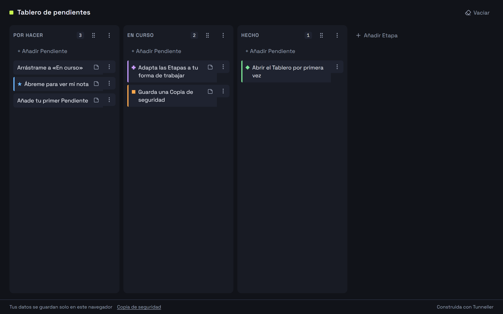

# Tablero de pendientes

Organiza tus Pendientes en un tablero visual y muévelos entre Etapas. Sin cuentas: tus datos se quedan en tu navegador.

Pruébala: https://tunneller-demo.github.io/kanban/

Construida con Tunneller
